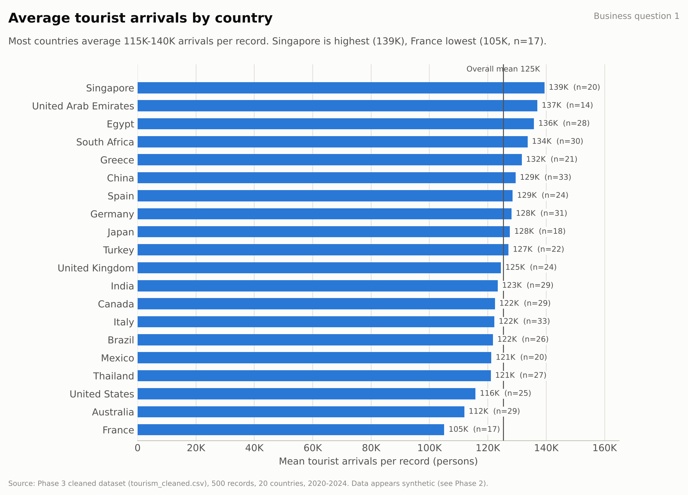
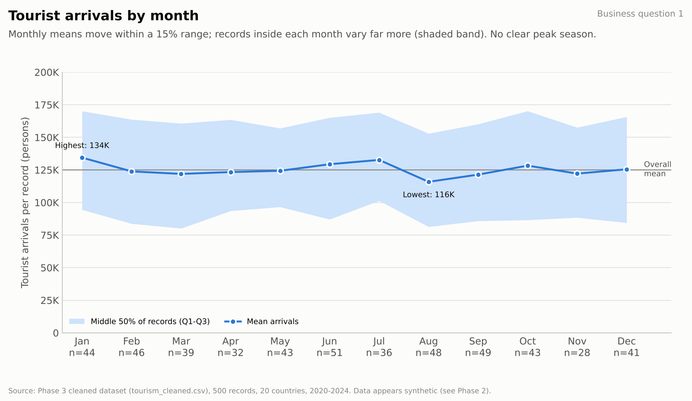
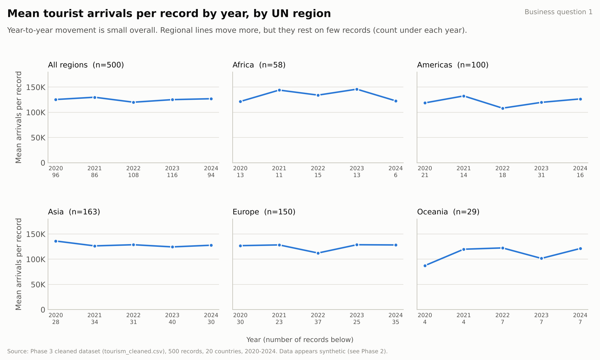
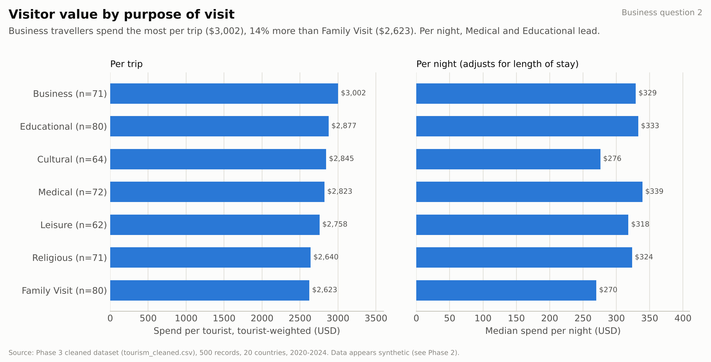
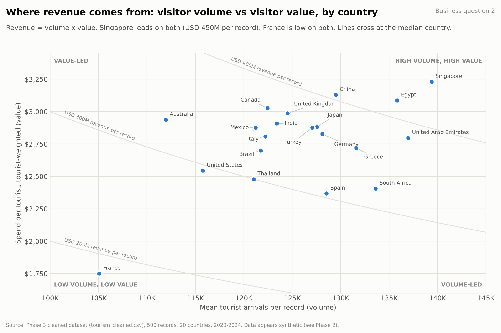
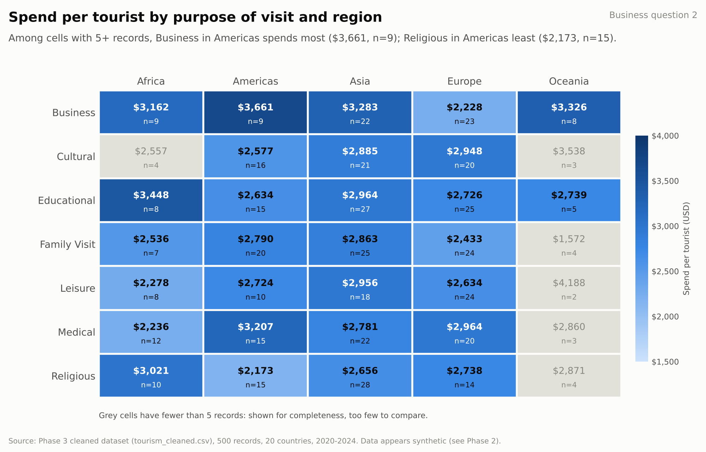
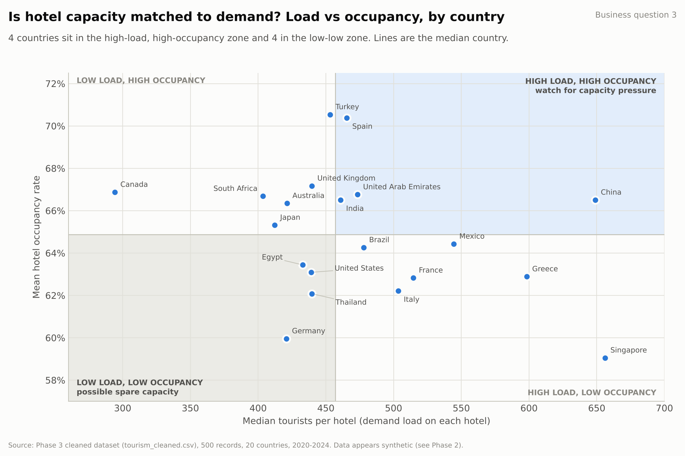
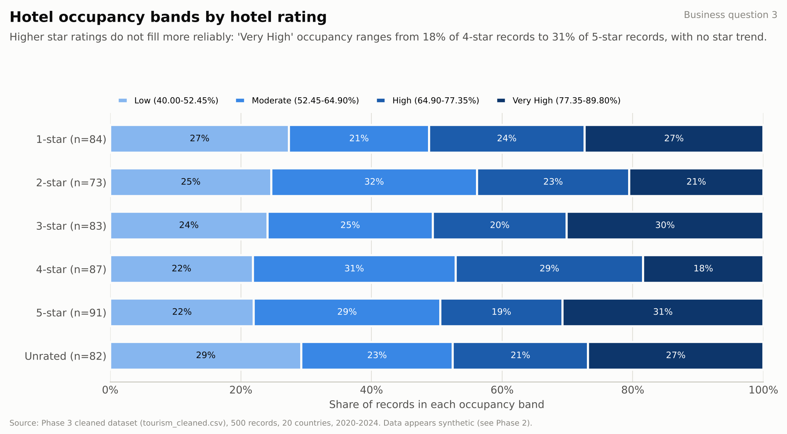

# Phase 5: Data Visualization and Dashboard

This phase turns the descriptive results into charts that a tourism authority or hotel manager can read quickly. Each chart answers one of the business questions from [Phase 1](phase1.md). The Tableau dashboard puts the most useful views next to the headline KPIs.

All charts use the Phase 3 cleaned dataset, `data/processed/tourism_cleaned.csv` (500 records, 51 columns), which [Phase 3](phase3.md) prepared for this phase. No values were changed. The script `analysis/phase5_visualizations.py` draws every chart and saves the numbers behind each one to `outputs/phase5/`, so every figure in this report can be traced to a CSV file.

| Business question | Charts |
|---|---|
| Q1. Which destinations and time periods attract the most tourists? | Figures 1, 2, 3 |
| Q2. Which segments and destinations generate the highest economic value? | Figures 4, 5, 6 |
| Q3. Is hotel capacity being used efficiently across destinations? | Figures 7, 8 |
| Q4. Can demand be predicted? | Covered in Phase 6. The flat patterns in Figures 1 to 3 already suggest how little signal the model will have to work with. |

## 1. Headline KPIs

These are the KPI cards on the dashboard. The script also writes them to `outputs/phase5/kpi_summary.csv` with the Tableau formula for each, which we used to check the dashboard numbers.

| KPI | Value | How it is calculated |
|---|---|---|
| Records | 500 | Count of records |
| Total observed arrivals | 62,631,942 | Sum of `Number_of_Tourists` across records |
| Mean arrivals per record | 125,264 | Average of `Number_of_Tourists` |
| Spend per tourist (tourist-weighted) | USD 2,792 | Σ revenue ÷ Σ arrivals, i.e. what the average tourist spent |
| Total observed revenue | USD 174,869 million | Σ `Tourism_Revenue_USD_000` ÷ 1,000 |
| Mean hotel occupancy | 64.8% | Average of `Hotel_Occupancy_Rate` |
| Median tourists per hotel | 440 | Median of `Tourists_per_Hotel` |

The sums only add up the records in the dataset. Because the records cover cities and months unevenly (Phase 4, section 1), they should not be read as national or annual totals. Spend per tourist is weighted by arrivals, so a record with 190,000 tourists counts for more than one with 60,000. The result matches the Phase 4 figure of USD 2,792.01.

## 2. Design choices

The chart type follows the question. Ranked bars compare categories, lines show change over months and years, scatter plots show how two measures relate, the heatmap crosses two categories, and stacked 100% bars show a mix.

Group sizes in this dataset range from 2 to 163 records, and Phase 4 warned that rankings can mislead when the group size is hidden. Every bar, point and cell therefore shows its number of records (n).

Bars start at zero so that differences are not exaggerated. The country differences in Figure 1 look small because they are small.

We used one blue for single-series charts and added colour only where it carries meaning. The heatmap uses a light-to-dark blue scale, and the occupancy bands use an ordered blue ramp that we checked for colour-blind readability. Cells with too few records are grey.

Each chart has a title, a one-line takeaway, axis titles with units, the business question it answers, and a source line noting that the data appears synthetic. Revenue is stored in thousand USD (Phases 2 and 3) and shown in USD million. Occupancy is a percentage, and spend is in USD per tourist or per night.

## 3. Charts and what they tell the business

### Q1. Where and when do tourists come?



Figure 1 ranks the 20 countries by mean arrivals per record. Singapore (139,382, n=20), the UAE (136,960, n=14) and Egypt (135,807, n=28) are highest, and France (105,060, n=17) is lowest. Most countries fall between 115,000 and 140,000, within about 12% of the overall mean of 125,264.

No destination is much more popular than the rest, so arrivals alone cannot justify a bigger promotion budget for any one country. France trails clearly, though it has only 17 records. We compare means because sums mostly reflect record counts: China has the largest total in Phase 4 largely because it has 33 records.



Figure 2 shows mean arrivals by month, with a shaded band for the middle 50% of records. January has the highest mean (134,449) and August the lowest (115,872). The twelve monthly means fit inside a range equal to 15% of the overall mean, while records within a single month run from about 80,000 to 170,000.

Since the variation within a month is far larger than the difference between months, this sample has no clear peak season, and staffing or pricing plans should not assume one. The hemisphere-aware `Season` column tells the same story: Summer 127,083, Winter 126,209, Spring 125,761, Autumn 121,662.



Figure 3 shows mean arrivals by year for all records and for each UN region, with all panels on one scale. The overall yearly mean stays between 120,036 (2022) and 129,925 (2021). Africa and Oceania move more, but Oceania has only 4 to 7 records a year and Africa has 6 in 2024.

There is no steady growth or decline to plan around, and the regional swings rest on too few records to treat as trends. The data also shows no dip in 2020 and 2021, when real-world tourism collapsed, which is more evidence that the dataset is synthetic (Phase 2).

### Q2. Which segments and destinations bring the most value?



Figure 4 compares visitor value by purpose of visit. Per trip, Business travellers spend the most (USD 3,002, tourist-weighted) and Family Visit travellers the least (USD 2,623), a gap of about 14%. Per night, which adjusts for length of stay, Medical (USD 339) and Educational (USD 333) lead, and Family Visit (USD 270) and Cultural (USD 276) are lowest.

Business, Educational and Medical visitors rank high on both measures, which makes them the obvious segments for targeted marketing. Family Visit is the lowest-value segment on both. Each purpose has between 62 and 80 records, so the comparisons rest on similar sample sizes.



Figure 5 places each country by volume (mean arrivals) and value (spend per tourist). Revenue equals arrivals × spend, so each curved line joins points with the same revenue per record. Singapore (USD 450 million per record), Egypt (419) and China (405) are high on both axes. France (184) is low on both, mostly because its visitors spend the least (USD 1,750). South Africa and Spain are volume-led, with many tourists who spend little. Canada, the UK and Australia are value-led, with fewer tourists who spend more.

These two groups need different strategies. A volume-led destination can raise revenue by increasing spend per visitor, for example with packages or premium experiences. A value-led destination can raise it by attracting more visitors. A plain revenue ranking would show who earns the most; this chart also shows why.



Figure 6 crosses purpose of visit with UN region. Among cells with at least 5 records, Business in the Americas spends the most (USD 3,661, n=9) and Religious in the Americas the least (USD 2,173, n=15). Business travel to Europe (USD 2,228, n=23) is among the lowest cells, even though Business is the top segment overall. Six cells in Oceania and Africa have fewer than 5 records and are greyed out.

So a segment's value depends on where it travels. A single global campaign aimed at Business travellers would overlook that Business visitors to Europe spend less than most segments elsewhere. Marketing should be planned by region and segment, using the cells with enough records.

### Q3. Is hotel capacity matched to demand?



Figure 7 compares each country's demand load (median tourists per hotel) with its mean hotel occupancy. The median country on each measure splits the chart into four zones:

| Zone | Countries | Reading |
|---|---|---|
| High load, high occupancy | China, India, Spain, United Arab Emirates | Hotels are busy on both measures; watch for capacity pressure |
| Low load, low occupancy | Egypt, Germany, Thailand, United States | Possible spare capacity |
| High load, low occupancy | Brazil, France, Greece, Italy, Mexico, Singapore | Many tourists per hotel, yet rooms are less full |
| Low load, high occupancy | Australia, Canada, Japan, South Africa, Turkey, United Kingdom | Fewer tourists per hotel, yet rooms are fuller |

Across all 500 records, tourists per hotel and occupancy are almost unrelated (r = −0.06), which matches Phase 4.

The two diagonal zones are the ones a manager can act on. China, India, Spain and the UAE should have their capacity reviewed before demand grows. Egypt, Germany, Thailand and the US look like places to build demand through promotion or pricing before adding hotels. The other two zones are harder to explain. Singapore has the most tourists per hotel but the lowest occupancy (59.0%). In real data that would raise questions about hotel size and length of stay; here it comes from variables that were generated independently. The dataset counts hotels, not rooms, so the matrix can flag possible mismatches but cannot measure efficiency.



Figure 8 shows how each hotel tier's records split across the four occupancy bands from Phase 3. The share in the "Very High" band (77.35% to 89.80%) ranges from 18% for 4-star hotels to 31% for 5-star hotels, with no pattern by star level. Unrated hotels look much like rated ones.

In this sample, a higher star rating does not mean fuller hotels. Investors should not expect an upgrade or a new premium property to raise occupancy by itself.

## 4. Interactive Tableau dashboard

The dashboard is in `Phase 5_DOM304_Tourism_Dashboard.twbx`, on the dashboard tab `Phase 5_DASHBOARD`. It is built in Tableau from the same cleaned file, and the data is packaged inside the workbook, so it opens without the CSV. It is also published on Tableau Public: [Phase 5 DOM304 Tourism Dashboard](https://public.tableau.com/app/profile/soham.shah1897/viz/Phase5_DOM304_Tourism_Dashboard/Phase5_DASHBOARD). The same link is saved in `Phase 5 DASHBOARD_Tableau Public Link.txt`.

To keep it uncluttered, the dashboard has five KPI cards, four filters and four views, with one or two views per business question:

| Area | Content | Question | Interaction |
|---|---|---|---|
| Top left | KPI cards: arrivals per record, spend per tourist, revenue, occupancy, records | All | Update with every filter and map selection |
| Top right | Drop-down filters for year, UN region, purpose of visit and hotel rating | All | Apply to every view |
| Middle left | World map of mean arrivals per record, with revenue, spend and occupancy in the tooltip | Q1, Q2 | Clicking a country filters the KPIs, monthly chart and purpose chart |
| Middle right | Mean arrivals by month, with the overall mean as a reference line | Q1 | Follows the map and filters |
| Bottom left | Spend per tourist by purpose of visit | Q2 | Follows the map and filters |
| Bottom right | Load vs occupancy matrix, coloured by capacity zone | Q3 | Clicking a country on the map highlights it here |

For example, a manager can select Asia and the Business segment to see how many tourists that segment brings, what they spend, which months are busiest and which countries are under capacity pressure.

## 5. Limitations

1. The data appears synthetic. Phase 2 showed the variables are close to uniform and nearly independent, so most charts are flat. The business readings above show how the method works and are not evidence about real tourism markets.
2. Coverage is uneven. Countries have 14 to 33 records, and some region-year and purpose-region groups have fewer than 10. Small groups are flagged with n or greyed out, and their values should not drive decisions.
3. Summed arrivals and revenue depend on how many records a group has, so the charts compare means and weighted rates.
4. Capacity is approximate. The data has hotel counts but no room counts or room-nights, so tourists per hotel and occupancy can only flag possible mismatches.
5. None of the charts shows that one variable causes another. Phase 6 tests whether these variables can predict arrivals.

## 6. Files and reproduction

Run from the repository root (Python 3.10+, numpy and matplotlib; pandas is not required):

```sh
python analysis/phase5_visualizations.py
```

| File | Contents |
|---|---|
| `analysis/phase5_visualizations.py` | Builds all eight charts, their data files and the KPI summary |
| `outputs/phase5/fig1_arrivals_by_country.png` … `fig8_occupancy_band_by_rating.png` | The eight report charts |
| `outputs/phase5/chart_data_fig1.csv` … `chart_data_fig8.csv` | The numbers plotted in each chart, with record counts |
| `outputs/phase5/kpi_summary.csv` | Headline KPIs with their Tableau formulas, used to check the dashboard |
| `Phase 5_DOM304_Tourism_Dashboard.twbx` | Tableau packaged workbook with the dashboard (data included) |
| `Phase 5 DASHBOARD_Tableau Public Link.txt` | Link to the published dashboard on Tableau Public |
